<div align="center">


<br>

<a href="https://thijn.douwma.me"></a>&nbsp;&nbsp;<a href="https://thijn.douwma.me/?lang=en"></a>&nbsp;&nbsp;<a href="https://thijn.douwma.me/?lang=nl"></a>

<br>

[](https://github.com/SudoThijn/portfolio/actions/workflows/deploy.yml)

</div>

<br>

<h2>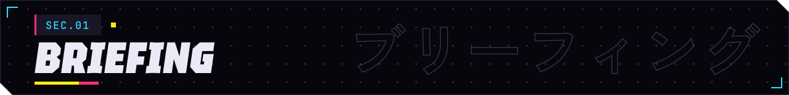</h2>

A CV that plays like a game. The profile is a character sheet, the skills are stat bars, the jobs and studies are a quest log, and the projects are builds. Around it sits a HUD with a live clock in Dronten, a scroll meter and a sound switch, over a dot field that reacts to the cursor.

It is built as a Vue 3 and TypeScript app with a single runtime dependency, and it is bilingual: English by default, Dutch one click away.

<h2>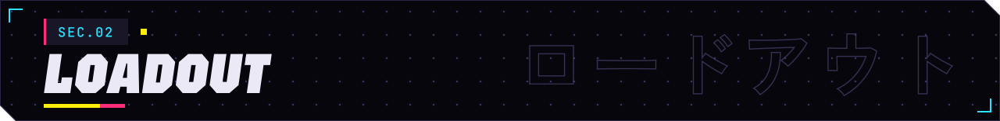</h2>


<h2>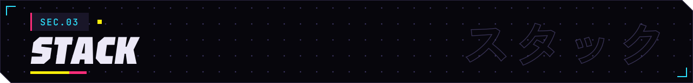</h2>

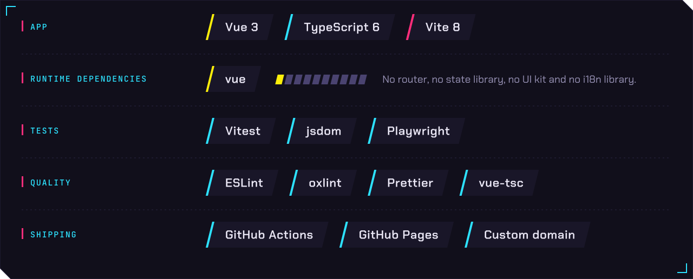

<h2>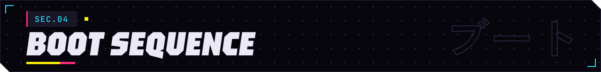</h2>

You need Node `^22.18` or `>=24.12`.

```sh
npm ci
npm run dev
```

| Command | What it does |
|---|---|
| `npm run dev` | Starts the dev server with hot reload. |
| `npm run build` | Type-checks, then builds into `dist/`. |
| `npm run preview` | Serves the production build. |
| `npm run test:unit` | Runs the Vitest unit tests. |
| `npm run test:e2e` | Runs the Playwright suite. |
| `npm run lint` | Runs oxlint and ESLint, with fixes. |
| `npm run format` | Runs Prettier over `src/`. |

The first Playwright run needs its browsers: `npx playwright install`.

By default the end-to-end suite runs against `design_example/`, the static reference design that the Vue app was rebuilt from. To test the Vue app itself, start the dev server and point the suite at it. A few specs, such as the language and age ones, only run this way.

```sh
npm run dev
E2E_URL=http://localhost:5173 npm run test:e2e
```

<h2>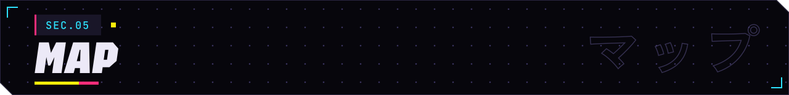</h2>

```text
src/
├─ components/    The page sections, the HUD and the language switch
│  └─ eggs/       Dialogs and overlays that belong to the secrets
├─ eggs/          The behaviour behind the secrets
├─ i18n/          The typed EN and NL dictionaries, and t()
├─ lib/           Dot field, reticle, sound engine, password analysis, age
├─ assets/        Stylesheet and audio
└─ __tests__/     Unit tests
e2e/              Playwright specs
design_example/   The static reference design
docs/art/         The SVG artwork in this README
scripts/          The generator for that artwork
.github/workflows Deploys to GitHub Pages
```

<h2>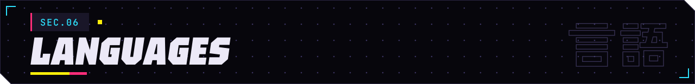</h2>

Every visitor-facing string lives in `src/i18n/en.ts`, which defines the keys. `src/i18n/nl.ts` is typed against it, so a missing Dutch string fails the type check. Components call `t('some.key')`, and `{name}` placeholders are filled from a second argument.

Some things stay English on purpose: the terminal's commands and file names (so Tab completion works in both languages), proper names, and the katakana. Adding a third language means adding it to `LOCALES`, writing its dictionary, and giving it a locale code for dates in `src/lib/env.ts`.

<h2>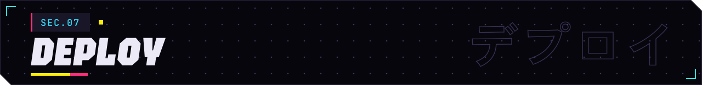</h2>

Every push to `main` builds the site in GitHub Actions and publishes it to GitHub Pages. The site lives at the root of `thijn.douwma.me`, which is a `CNAME` from `thijn` to `sudothijn.github.io`, so the build needs no base path.

<h2>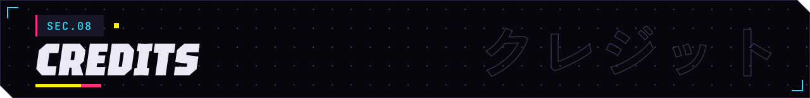</h2>

The sounds come from [OpenGameArt](https://opengameart.org). They were converted to OGG, and some were trimmed or changed in volume. The same list is in the page, under the footer's *Sound credits*.

| Work | By | Used for | Licence |
|---|---|---|---|
| [Sci-Fi Pack Vol 1](https://opengameart.org/content/jc-sounds-sci-fi-pack-vol-1) | JC Sounds | Charge shot and the background hum | CC BY 4.0 |
| [SFX sampler](https://opengameart.org/content/packsmithy-sfx-sampler-30-synthesised-sound-effects-ui-retro-horror-sci-fi-glitch) | Packsmithy (packsmithy.com) | Level up | CC BY 4.0 |
| [Sci-Fi Sound Library](https://opengameart.org/content/sci-fi-sound-effects-library) | Little Robot Sound Factory (www.littlerobotsoundfactory.com) | 1337 mode | CC BY 3.0 |
| [UI Menu Open and Close](https://opengameart.org/content/ui-menu-open-and-close) | FiveBrosStopMosYT | Popups | CC BY 4.0 |
| [Hard Boss Battle 1](https://opengameart.org/content/hard-boss-battle-1) | | Overdrive music | CC0 |
| [Hi-Tech Button Sound Pack I](https://opengameart.org/content/hi-tech-button-sound-pack-i-non-themed) | Circlerun | Cursor lock-on | CC0 |
| [UI Sounds](https://opengameart.org/content/ui-sounds-0) | HaelDB | Achievement toast | CC0 |
| [Single Key Press Sounds](https://opengameart.org/content/single-key-press-sounds) | eklee, extracted by qubodup | Terminal keystrokes | CC BY 3.0 |

The fonts are Chakra Petch, JetBrains Mono, Tektur and Zen Kaku Gothic New, loaded from Google Fonts. The same four are drawn as outlines in the SVG artwork of this README.

<h2>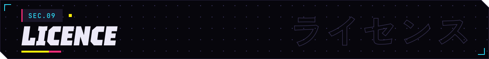</h2>

There is no licence file yet, so the code is here to read, not to reuse. Ask first.

<br>

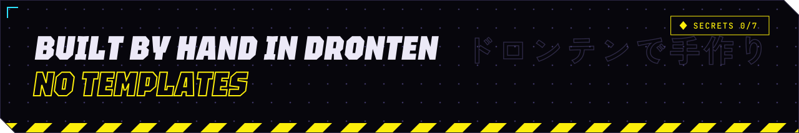

<div align="center">

[thijn.douwma.me](https://thijn.douwma.me) &nbsp;·&nbsp; [GitHub](https://github.com/SudoThijn) &nbsp;·&nbsp; [LinkedIn](https://www.linkedin.com/in/thijn-douwma/)

</div>
